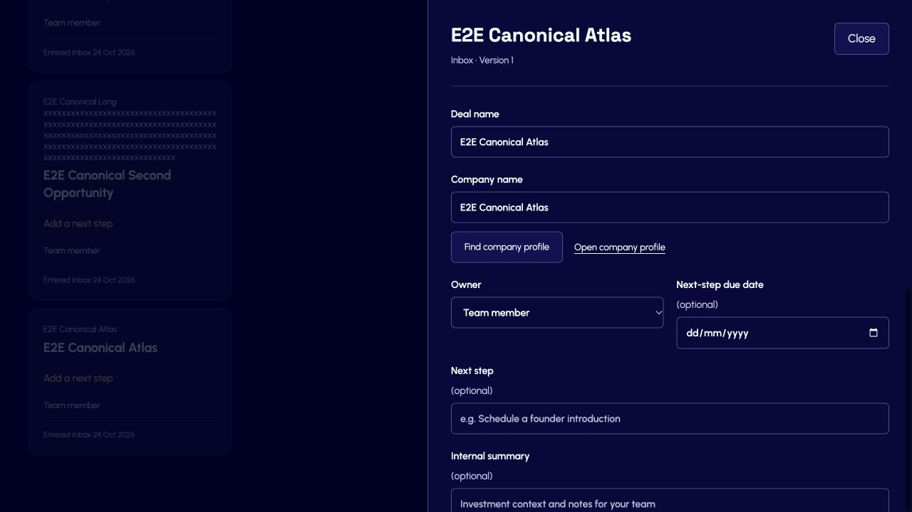

# Deal Pipeline canonical company integration — 24 October 2026

## Scope and preflight

Checkout: `/Users/mf/dev/nextgentool`; shared branch `MichaelF/research-diligence-mvp`, with concurrent unrelated domain work. This task changed the Pipeline lookup/composition, firm mapping/provisioning, name limits, asynchronous search guards, migration0008, focused tests, and documentation. It did not commit, push, or deploy.

Environment: owned production Next.js preview at `http://localhost:3100`, exact local PostgreSQL `localhost:5432/nextgentool_pipeline`. Migration0008 applied locally. Existing approved Clerk account was authenticated; both Pipeline and Company Intelligence pages loaded under its real session. The owned server inherited `DISABLE_EMAILS=true`; tested paths send no notifications. No real verification email was sent and no Clerk account settings were changed. Other tasks' servers remained untouched.

The Pipeline firm `74a6f8f4-ec0f-46c9-a728-e4609f58bccd` was explicitly connected to existing Research firm `859834c3-4164-4ceb-90a3-81bffb05ca63`. The approved user already had Research admin membership. The connection does not create or expand Research memberships. Synthetic authorization tests use separate randomly generated firms and identities.

Browser work used the Codex in-app browser, real HTTP routes, application services, and PostgreSQL. An independent coverage/code reviewer examined mapping isolation, permissions, names, and asynchronous response ordering. Browser writes used disposable companies/deals only; no production or external storage was accessed.

## Implementation

- Company lookup calls Company Intelligence's list/profile services through a Pipeline adapter.
- Explicit firm mapping plus the enabled Pipeline actor's Clerk identity must match existing Research membership. Company repository reads recheck membership. Viewer membership is sufficient for company reads.
- Search matches canonical names and domains; new selections resolve authoritative name and relative profile path on the server.
- Pipeline company/deal names now accept200 characters, matching the canonical registry.
- Request-generation guards discard stale search/duplicate responses after editing, closing, reopening, or selecting another identity. Search clears old options; selection clears pending search state.
- Provisional names remain available. Existing links retain display snapshots on unrelated edits; the actual Company profile still requires current Research access.

## Cases and results

All cases target the local environment. C01–C09 require the authenticated approved account, enabled Pipeline membership, mapped Research membership, and disposable company fixtures. No unrelated records may be changed.

| ID | Method | Steps | Expected and observed | Status |
|---|---|---|---|---|
| C01 | Browser | Create E2E Canonical Atlas from Company directory after duplicate preview | Canonical profile created with name/domain under real session | pass |
| C02 | Browser | In Add deal, search canonical-atlas.example.com, then later partial Canonical Atlas | Both return the same real canonical company | pass |
| C03 | Browser + DB | Select Atlas, leave deal name empty, create; reload, reopen, click Open company profile | Stored canonical ID/name/path; default deal name; actual authenticated profile shows Atlas/domain | pass |
| C04 | Browser | Add another deal, select Atlas | Existing active opportunity advisory appears; distinct second opportunity saves | pass |
| C05 | Browser + DB | Edit second deal's company text to a nonexistent provisional name, search, save/reload | Link clears; no-match fallback; null canonical ID/path persists and audit records unlink | pass |
| C06 | Browser + DB | Search/select 200-character Long profile from provisional second deal and save | Correct new ID/name/path at version3; audit retains earlier identity changes | pass |
| C07 | Browser + DB | Create Long canonical profile through Company UI; select in a new deal with blank deal name | Full200-character company and default deal names persist without truncation | pass |
| C08 | Browser + fault proxy | Hold successful Atlas search response; change query/search Long; deliver Long then release Atlas | Long remains selected search result; stale Atlas does not replace it; search button enabled | pass |
| C09 | Browser + fault proxy | Hold Atlas duplicate response; select Long and receive its advisory; release Atlas | Long profile link and Long/Second Opportunity advisory remain; stale Atlas advisory ignored | pass |
| C10 | PostgreSQL application integration | Missing mapping; mismatched Research firm; foreign company ID; revoke membership after search; viewer membership | Missing/mismatched/revoked access denied; foreign ID not found; viewer reads succeed; provisional creation still works | pass |
| C11 | PostgreSQL application integration | Supply canonical ID with tampered name; link/unlink and read history; canonical name200 | Server canonical name/path wins; ID changes audited; full names round-trip | pass |

C10–C11 use the real adapter, both application services and PostgreSQL repositories with synthetic contexts, not a browser role switch. Browser authentication itself is real Clerk. Existing HTTP tests additionally cover input/origin validation. The initial proxy hold implementation consumed redirect responses; it was corrected to hold successful responses and rerun with explicit “Held response” evidence before releasing them.

## Automated checks

- Final combined suites: **37/37 passed** —19 HTTP tests and18 PostgreSQL integration tests (five new canonical cases).
- Targeted Biome passed.
- TypeScript passed.
- Final production build passed after the search-state fix.

```sh
PIPELINE_INTEGRATION_TEST=true DATABASE_URL=postgres://mf@localhost:5432/nextgentool_pipeline pnpm --filter @repo/web test src/modules/deal-pipeline/infrastructure/pipeline.integration.test.ts src/modules/deal-pipeline/presentation/http.test.ts
pnpm --filter @repo/web typecheck
pnpm --filter @repo/web build
```

The database suite requires explicit opt-in and validates the exact localhost database before writing. Its random fixtures are removed afterward.

## Evidence and cleanup



Three browser deals, two canonical companies, and their request/audit/history records were removed with exact firm/fixture predicates and asserted counts. Both local firm inventories returned to zero. Approved real memberships and the explicit firm connection remain intact. The standalone3101 proxy was stopped; the clean authenticated board remains on3100. The preview uses an isolated build snapshot so concurrent builds do not change the tested output.

Fault harness: `apps/web/tests/pipeline-network-proxy.mjs`. In addition to previous response-loss modes, hold-company-search and hold-duplicates buffer one successful response until release is entered on stdin. The harness is not imported or deployed by the app.

No required canonical case remains skipped or blocked. Production deployment and canonical rename/merge synchronization are outside this task; names/paths remain documented display snapshots.
